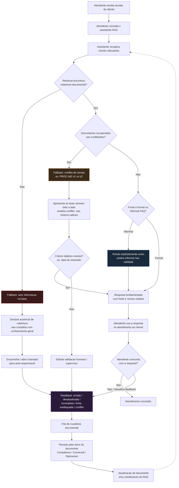

# Resolução — Cenário-Âncora 1
## Product Specialist

---

## 1. Introdução

Este documento apresenta a resolução integral dos Exercícios 1.1, 1.2 e 1.3 do Cenário-Âncora 1, elaborada sob a perspectiva de um Product Specialist sênior responsável por um assistente de IA generativa (RAG) para o time de atendimento da NovaTech.

Toda a análise foi construída exclusivamente a partir de três fontes: o enunciado do Cenário-Âncora 1, o **Anexo A — Documentação Simulada da NovaTech** (cinco documentos: POL-001, PROC-042 v1, PROC-042 v2, SLA-2024 e FAQ-Atendimento) e o **Anexo B — Chunks de Referência do Pipeline de RAG**. Nenhuma informação externa, prazo, regra, procedimento ou política foi inventado. Sempre que um dado necessário para uma decisão de produto não estava disponível nos anexos, isso é declarado explicitamente, com a lacuna tratada como um item de Discovery — nunca preenchida por suposição.

O objetivo não é apenas demonstrar "uso de IA", mas demonstrar disciplina de **Engenharia de Contexto**: como decidir o que entregar ao modelo, em que ordem, com que granularidade, e como isso afeta a qualidade do grounding, a prevenção de alucinação e a rastreabilidade das respostas — em um domínio real onde a própria documentação da empresa é ambígua e conflitante entre si. Essa ambiguidade documental (duas versões coexistentes do PROC-042, um FAQ informal sem dono, lacunas de cobertura) não é tratada como ruído a ser escondido, mas como o problema central de produto que a especificação de requisitos do Exercício 1.3 precisa resolver.

---

## 2. Exercício 1.1 — Mapeamento de Intent com Engenharia de Contexto

### 2.1 Estratégia geral

A estratégia adotada segue **Progressive Disclosure** aplicado à Engenharia de Contexto: em vez de despejar os cinco documentos completos no primeiro prompt, o contexto é entregue ao modelo em camadas crescentes de profundidade, cada uma justificada pelo resultado da camada anterior.

- **Etapa 1 — Visão geral:** apenas metadados (título, versão, data, responsável, classificação) e o objetivo declarado de cada documento. Nenhum conteúdo normativo é fornecido.
- **Etapa 2 — Análise profunda:** conteúdo completo apenas dos documentos priorizados na Etapa 1 (PROC-042 v1 e v2).
- **Etapa 3 — Cruzamento:** os outputs das Etapas 1 e 2 somados ao conteúdo integral do FAQ-Atendimento.

Essa sequência simula, de forma controlada por um humano, o que um pipeline de RAG bem projetado deveria fazer automaticamente via retrieval seletivo: apresentar ao modelo apenas o contexto relevante para a tarefa corrente, preservando **orçamento de atenção** para o que importa e reduzindo a superfície de erro.

### 2.2 Etapa 1 — Visão geral

**Por que começar pela visão geral, e não pelos documentos completos**

Um Product Specialist que já conhece o domínio poderia ser tentado a pular direto para os PROC-042, pois "sabe" que ali estão as contradições mais óbvias. Mas o objetivo da Etapa 1 não é confirmar uma hipótese prévia — é permitir que o **próprio mapeamento de temas e riscos emerja dos metadados**, de forma auditável, antes de qualquer viés de leitura profunda. Isso tem três vantagens práticas de engenharia de contexto:

1. **Custo de atenção:** um modelo (ou um analista humano) que recebe 5 documentos completos de uma vez tende a distribuir atenção de forma menos previsível entre eles; metadados isolados forçam uma triagem estrutural primeiro.
2. **Detecção de sinais estruturais antes de sinais de conteúdo:** só de olhar os metadados já é possível perceber, por exemplo, que dois documentos versionam o mesmo tema (frete especial) e nenhum deles tem um campo formal de "vigente/obsoleto" — um problema de governança documental que não depende de ler uma linha da fórmula de cálculo.
3. **Rastreabilidade da decisão de priorização:** ao documentar o "porquê" da escolha dos documentos da Etapa 2 com base apenas em metadados, a decisão fica auditável e repetível, em vez de ser uma escolha arbitrária do analista.

**Prompt utilizado — Etapa 1**

```
Você é um assistente de análise documental para um Product Specialist de IA.
Vou fornecer APENAS os metadados de 5 documentos da NovaTech (título, versão,
data, responsável, classificação e objetivo declarado). NÃO tenho o conteúdo
normativo completo nesta etapa — não infira regras, valores, prazos ou
fórmulas que não estejam explicitamente nos metadados abaixo.

Documentos:

1. POL-001 — Política de Devolução de Mercadorias
   Versão: 3.1 | Última atualização: 15/01/2024 | Responsável: Diretoria de
   Operações | Classificação: Documento normativo — uso obrigatório
   Objetivo: define regras e procedimentos para devolução de mercadorias.

2. PROC-042 — Procedimento de Cálculo de Frete Especial
   Versão: 1.0 | Emissão: 03/03/2023 | Responsável: Diretoria Comercial
   Status: sem indicação formal de vigência ou obsolescência; coexiste com
   PROC-042-v2
   Objetivo: fórmula e parâmetros de frete especial para cargas > 500kg.

3. PROC-042-v2 — Procedimento de Cálculo de Frete Especial (Revisado)
   Versão: 2.0 | Emissão: 10/11/2023 | Responsável: Diretoria Comercial
   Status: sem indicação formal de que substitui a v1; ambos coexistem
   Objetivo: fórmula atualizada de frete especial para cargas > 500kg.

4. SLA-2024 — Tabela de SLA por Tipo de Cliente
   Versão: 2024.1 | Última atualização: 02/01/2024 | Responsável: Diretoria
   Comercial + Diretoria de Operações | Classificação: documento contratual
   Objetivo: SLAs formais por tier de cliente.

5. FAQ-Atendimento — Perguntas Frequentes do Time de Suporte
   Versão: não controlada | Atualização: diversas (documento colaborativo)
   Responsável: nenhum responsável formal | Classificação: documento
   informal, NÃO validado por Compliance ou Operações
   Objetivo: registrar conhecimento prático do time de atendimento.

Com base SOMENTE nessas informações (não invente conteúdo normativo):
1. Produza um mapa de temas cobertos pela documentação.
2. Levante hipóteses de gaps documentais visíveis já nesta camada de metadados.
3. Aponte quaisquer sinais de risco estrutural (governança, versionamento,
   confiabilidade da fonte) perceptíveis só pelos metadados.
4. NÃO avalie ainda o conteúdo técnico (fórmulas, prazos, multiplicadores) —
   isso será feito em etapa posterior com o conteúdo integral.
```

**Output esperado/obtido — Etapa 1**

*Mapa de temas identificados*

| Tema | Documento(s) associado(s) | Natureza |
|---|---|---|
| Devolução de mercadorias | POL-001 | Normativa formal |
| Frete especial (cargas > 500kg) | PROC-042, PROC-042-v2 | Normativa formal, **duplicada em duas versões** |
| SLA e classificação de clientes (tiers) | SLA-2024 | Contratual formal |
| Conhecimento prático de atendimento | FAQ-Atendimento | Informal, não validado |

*Hipóteses de gaps (baseadas apenas em metadados)*

- Existem dois documentos formais cobrindo exatamente o mesmo processo (frete especial), sem nenhum campo de metadado que indique qual está vigente. Isso é, por si só, um risco de produto antes mesmo de comparar o conteúdo.
- Não há, entre os cinco títulos, nenhum documento sobre "frete padrão" (presumivelmente para cargas abaixo de 500kg) — hipótese de gap de cobertura a confirmar nas etapas seguintes.
- O FAQ-Atendimento é o único documento sem responsável formal e sem controle de versão — isso o torna estruturalmente diferente dos demais e candidato a ser tratado com regras de confiança distintas em qualquer pipeline de RAG.
- POL-001 e SLA-2024 têm metadados completos e atualizados recentemente (jan/2024), sugerindo maior maturidade de governança nesses dois temas em comparação ao frete especial.

*Justificativa da decisão de contexto*

Fornecer apenas metadados nesta etapa é uma aplicação direta de orçamento de atenção: o objetivo da Etapa 1 não é obter uma resposta operacional (ex.: "qual o prazo de devolução"), e sim construir um **mapa de risco estrutural da base documental**. Se o conteúdo completo fosse fornecido aqui, o modelo (e o analista humano revisando o output) tenderia a responder perguntas de conteúdo prematuramente, sem ainda ter decidido quais documentos merecem investigação aprofundada — misturando duas tarefas cognitivas diferentes (triagem vs. análise) na mesma passada.

### 2.3 Etapa 2 — Análise profunda

**Documentos selecionados: PROC-042 (v1) e PROC-042-v2**

**Justificativa da escolha:** a Etapa 1 identificou que esses são os dois únicos documentos que versionam o mesmo processo normativo sem indicação formal de vigência — o maior risco estrutural encontrado no mapa de metadados. Diferente de POL-001, SLA-2024 ou FAQ (que não têm conflito de versão explícito entre si), o par PROC-042/PROC-042-v2 representa uma contradição documental ativa que impacta diretamente um cálculo financeiro (valor do frete cobrado do cliente). Por isso — e não por conhecimento prévio do enunciado — esses são os dois documentos priorizados para leitura integral.

**Prompt utilizado — Etapa 2**

```
Com base no mapa de risco da Etapa 1, vou fornecer agora o conteúdo INTEGRAL
de apenas dois documentos: PROC-042 (v1.0, 03/03/2023) e PROC-042-v2 (v2.0,
10/11/2023). Não fornecerei ainda POL-001, SLA-2024 ou o FAQ.

[conteúdo integral de PROC-042 v1: seções 1 a 4]
[conteúdo integral de PROC-042 v2: seções 1 a 5]

Tarefa:
1. Compare as duas versões campo a campo (fórmula, fator de peso,
   multiplicadores regionais, prazo de entrega, condições especiais,
   descontos de volume).
2. Liste TODAS as divergências numéricas e de regra encontradas — não
   omita nem minimize nenhuma.
3. Para cada divergência, explique o risco operacional concreto se um
   atendente aplicar a versão errada.
4. Avalie a seção 5 (Disposições Transitórias) da v2: ela resolve o
   conflito de vigência entre as duas versões? Justifique.
5. Não decida sozinho qual versão é "a correta" — apenas descreva
   objetivamente o que cada uma diz e onde elas divergem.
```

**Output produzido — comparação PROC-042 v1 vs v2**

| Parâmetro | PROC-042 v1 | PROC-042-v2 | Divergência |
|---|---|---|---|
| Fator de peso — 500 a 1.000 kg | 1,0 | 1,0 | Igual |
| Fator de peso — 1.001 a 3.000 kg | 1,2 | 1,15 | **Diferente** |
| Fator de peso — acima de 3.000 kg | 1,5 | 1,4 | **Diferente** |
| Multiplicador Sul | 1,2 | 1,3 | **Diferente** |
| Multiplicador Sudeste | 1,0 | 1,1 | **Diferente** |
| Multiplicador Centro-Oeste | 1,3 | 1,4 | **Diferente** |
| Multiplicador Nordeste | 1,4 | 1,5 | **Diferente** |
| Multiplicador Norte | 1,6 | 1,8 | **Diferente** |
| Prazo adicional (manuseio) | + 2 dias úteis | + 3 dias úteis | **Diferente** |
| Regra de desconto por volume | Negociado caso a caso pelo Comercial, a partir de "mais de 10 fretes/mês", registrado em aditivo contratual | Automático: 5% a partir de 8 fretes/mês; 10% acima de 15 fretes/mês | **Diferente (automático vs. negociado, e limiares distintos)** |
| Vigência formal declarada | Nenhuma | Nenhuma (seção 5 fala de transição, mas não declara a v1 obsoleta) | **Ambígua em ambas** |

*Análise das inconsistências*

Todos os parâmetros numéricos do frete especial — fator de peso, multiplicadores regionais e prazo — divergem entre as duas versões, em alguns casos de forma significativa (multiplicador Norte: 1,6 vs. 1,8; um desvio de 12,5% no fator regional isoladamente). A regra de desconto por volume não é apenas numericamente diferente: é **estruturalmente diferente** — na v1 o desconto depende de negociação humana pelo Comercial e formalização em aditivo; na v2 é uma regra automática de tabela. Isso significa que um assistente que misturasse as duas versões poderia, por exemplo, aplicar o fator de peso da v1 com o multiplicador regional da v2 (ou vice-versa), produzindo um valor de frete que não corresponde a nenhuma das duas versões oficiais — um erro pior do que aplicar consistentemente uma versão desatualizada.

Quanto à Seção 5 (Disposições Transitórias) da v2: ela estabelece uma regra de corte por data de abertura do chamado (antes de 01/12/2023 usa v1; a partir dessa data usa v2), mas essa cláusula **não declara a v1 obsoleta de forma geral** — apenas regula chamados em transição naquele período específico. Não há, em nenhum dos dois documentos, uma declaração de que a v1 deixou de ser válida para consulta ou que foi arquivada. Do ponto de vista de um pipeline de RAG operando na data atual, ambos os documentos seguem formalmente "vivos" e indexáveis, o que é o cerne do problema de governança.

*Risco operacional identificado*

1. **Cobrança incorreta ao cliente:** se o assistente recuperar chunks de ambas as versões e não sinalizar o conflito, o atendente pode informar (ou até calcular) um valor de frete que não corresponde a nenhuma tabela oficial vigente, gerando disputa comercial, retrabalho e risco de contestação formal do cliente.
2. **Aplicação de desconto indevido:** confundir a regra de desconto automático da v2 com o processo negociado da v1 pode levar a conceder desconto sem aprovação da Diretoria Comercial (v1) ou, inversamente, negar um desconto automático a que o cliente teria direito pela v2 — ambos geram exposição financeira ou insatisfação do cliente.
3. **Prazo de entrega incorreto:** informar "+2 dias" quando a regra vigente seria "+3 dias" (ou vice-versa) gera expectativa incorreta de SLA junto ao cliente, com potencial de reclamação e, dependendo da interpretação, até de enquadramento como violação de SLA nos termos do documento SLA-2024.

**Explicação da decisão de contexto**

Fornecer o conteúdo integral de apenas esses dois documentos nesta etapa — e não ainda POL-001, SLA-2024 ou o FAQ — mantém o foco da análise no risco de maior severidade identificado na Etapa 1, evitando diluir a atenção do modelo com temas (devolução, SLA) que não têm conflito de versão ativo. Isso também torna a comparação mais precisa: ao isolar as duas versões lado a lado, divergências sutis (como o fator de peso 1,2 vs. 1,15) ficam mais visíveis do que ficariam se estivessem misturadas com outros três documentos no mesmo prompt.

### 2.4 Etapa 3 — Cruzamento

**Prompt utilizado — Etapa 3**

```
Você agora tem acesso a:
1. O mapa de temas e gaps da Etapa 1 (metadados dos 5 documentos).
2. A comparação detalhada PROC-042 v1 vs v2 da Etapa 2, incluindo as
   divergências numéricas e os riscos operacionais identificados.
3. O conteúdo INTEGRAL do FAQ-Atendimento (documento informal, não
   validado por Compliance ou Operações, sem responsável formal),
   incluindo os itens 3, 8, 15, 22, 27, 32, 38, 41 e 45.

Tarefa — cruze as três fontes:
1. Identifique itens do FAQ que estão ALINHADOS com a documentação formal
   (Etapas 1 e 2).
2. Identifique itens do FAQ que CONFLITAM com a documentação formal ou
   entre si.
3. Identifique itens do FAQ que tratam de assuntos SEM NENHUM respaldo em
   documento formal (POL/PROC/SLA) na amostra fornecida.
4. Para cada caso, avalie o risco de um assistente de RAG tratar o FAQ
   como fonte oficial equivalente aos documentos normativos.
5. Não decida por mim se o FAQ deve ou não ser usado — apenas evidencie
   os riscos e a natureza de cada informação (oficial, informal,
   hipótese, gap).
```

**Output da Etapa 3 — cruzamento**

*Alinhado com a documentação formal (com ressalvas)*

- **FAQ item 41** (diferença entre SLA de resposta e resolução) reproduz corretamente os prazos de SLA-2024 (Gold 2h/24h, Silver 4h/48h, Standard 8h/72h). É o item do FAQ com maior aderência à documentação formal.
- **FAQ item 15** (não existe tier Platinum) está alinhado com SLA-2024, que declara explicitamente "não existem outros tiers além dos três listados". Este é um caso raro em que o FAQ reforça corretamente a documentação oficial contra um mal-entendido do cliente.
- **FAQ item 8** (existência de duas versões do PROC-042) está parcialmente alinhado: reconhece corretamente que há duas versões e que a mais recente tem multiplicadores mais altos. Porém, a orientação "na dúvida, use a mais recente (v2)" é uma **heurística informal do time de atendimento**, não uma regra declarada em nenhum documento oficial — nem mesmo a Seção 5 da v2 autoriza esse critério de forma geral (ela só cobre a transição por data de abertura do chamado).

*Conflitante ou inconsistente*

- **FAQ item 45** (desconto por frete especial) afirma: "existe desconto automático na tabela [...] para clientes com mais de 10 fretes especiais por mês". Essa frase **não corresponde integralmente a nenhuma das duas versões do PROC-042**: a v1 usa o limiar de "mais de 10 fretes/mês", mas trata o desconto como **negociado** pelo Comercial (não automático); a v2 trata o desconto como automático, mas com limiares de 8 e 15 fretes/mês (não 10). O FAQ combina o limiar numérico da v1 com a natureza "automática" da v2, criando uma terceira regra que não existe em nenhum documento formal. Este é um conflito adicional, não listado explicitamente nas notas do Anexo A, identificado nesta análise de cruzamento.

*Presente apenas no FAQ, sem respaldo documental formal*

- **Item 3** (exceção informal para devolução de carga perigosa via ramal 4500) — descreve uma prática ("já tiveram casos em que o pessoal de Riscos autorizou exceção") sem qualquer procedimento formal documentado sobre os critérios dessa exceção.
- **Item 22** (percentuais de seguro de carga: 0,3% e 0,8%) — não há nenhum documento na amostra (POL, PROC ou SLA) que trate de seguro de carga.
- **Item 27** (estimativas de prazo de trânsito por região) — não há tabela formal de prazos de trânsito na amostra fornecida.
- **Item 32** (autorização do Compliance para carga perigosa com frete expresso) — não existe procedimento formal (POL ou PROC) que defina esse processo.
- **Item 38** (processo de carga danificada em trânsito, prazo de 48h, encaminhamento a sinistros@novatech.com.br) — não há documento formal (POL ou PROC) sobre carga danificada em trânsito na amostra.

*Riscos de tratar o FAQ como fonte oficial*

1. Para os itens 22, 27, 32 e 38, uma resposta gerada com base no FAQ teria **aparência de autoridade normativa** (cita prazos, percentuais, e-mails, procedimentos) sem que exista nenhum documento formal que sustente essas afirmações — o risco clássico de um RAG que não diferencia tipo de fonte na hora de compor a resposta.
2. O item 45 mostra que o próprio FAQ pode conter **informação internamente inconsistente com a documentação formal**, não apenas desatualizada — o que significa que "usar a versão mais recente entre FAQ e PROC" não é uma heurística segura, pois o FAQ não é necessariamente mais recente nem mais correto.
3. Nenhum item do FAQ tem data de última atualização por item, responsável ou processo de validação — não há como avaliar, por metadado, se uma entrada específica ainda reflete a prática atual da empresa.

**Análise crítica:** o cruzamento confirma a hipótese levantada já na Etapa 1 (FAQ estruturalmente diferente dos demais documentos) e mostra que o risco não é apenas "o FAQ pode estar desatualizado" — é que o FAQ pode **combinar informações corretas de fontes diferentes de forma incorreta** (caso do item 45), o que é mais difícil de detectar do que uma simples defasagem de data.

### 2.5 Comparação das etapas

| Aspecto | Etapa 1 | Etapa 2 | Etapa 3 |
|---|---|---|---|
| Objetivo | Mapear temas e riscos estruturais sem entrar em conteúdo normativo | Analisar profundamente o conflito de maior risco identificado (PROC-042 v1 vs v2) | Cruzar documentação formal + conflito identificado com o conhecimento informal do FAQ |
| Contexto fornecido | Apenas metadados (título, versão, data, responsável, classificação, objetivo) dos 5 documentos | Conteúdo integral de 2 documentos (PROC-042 v1 e v2) | Outputs das Etapas 1 e 2 + conteúdo integral do FAQ-Atendimento |
| Quantidade de informação | Mínima | Média, mas concentrada | Alta, porém curada (nenhum documento é reintroduzido na íntegra sem necessidade) |
| Tipo de análise | Triagem estrutural / mapeamento de temas | Comparação normativa detalhada, campo a campo | Cruzamento qualitativo entre fonte oficial e fonte informal |
| Benefício | Baixo custo, alta clareza sobre onde investir atenção | Alta precisão na identificação de divergências numéricas | Visão completa do risco de grounding em um cenário realista de atendimento |
| Risco | Pode gerar hipóteses de gap ainda especulativas, a confirmar depois | Ignora, por ora, POL-001 e SLA-2024 (risco assumido conscientemente) | Volume de contexto mais próximo do limite de atenção; risco de a análise final "empatar" fontes de credibilidade desigual se não houver rotulagem explícita |
| Qualidade esperada | Boa para triagem, insuficiente para responder perguntas operacionais | Alta para o tema específico analisado, mas isolada dos outros documentos | Mais completa e realista, mas depende da disciplina de manter a rotulagem oficial/informal explícita |

**Evolução da qualidade da análise:** a Etapa 1 produz uma visão ampla, porém rasa — suficiente para priorizar, insuficiente para decidir. A Etapa 2 produz profundidade, mas isolada: sem o restante do contexto, um observador poderia até supor que o conflito PROC-042 é o único problema da base documental. Só a Etapa 3, ao reintroduzir o restante do panorama (via os outputs já processados, não os documentos brutos) e cruzar com o FAQ, revela riscos de natureza diferente (fonte informal com aparência de autoridade) que não apareceriam nem na Etapa 1 nem na Etapa 2 isoladamente. A qualidade cresce porque cada etapa herda contexto já **processado e sintetizado**, não bruto — o que é a essência de progressive disclosure aplicado a engenharia de contexto.

### 2.6 Mapa de riscos

**Risco 1 — Ambiguidade de vigência entre PROC-042 v1 e v2**
- *Risco:* o assistente (ou o atendente) pode aplicar uma combinação inconsistente de regras de frete especial, ou aplicar consistentemente uma versão que não é mais a vigente na prática comercial.
- *Evidência documental:* nenhum dos dois documentos tem campo de status "obsoleto"/"vigente"; a nota do Anexo A confirma "nenhum dos dois documentos está marcado como obsoleto no SharePoint" e que a data de transição da Seção 5 da v2 (01/12/2023) já passou sem que a v1 tenha sido arquivada.
- *Impacto potencial:* cobrança incorreta de frete, disputa comercial, retrabalho do atendimento, exposição contratual.
- *Como levar ao Discovery:* apresentar a tabela comparativa da Etapa 2 como evidência concreta em uma entrevista com a Diretoria Comercial, perguntando diretamente qual versão reflete a tabela de preços praticada hoje.
- *Área a envolver:* Diretoria Comercial (dona do documento) e, se houver sistema de precificação separado, também o time responsável por esse sistema.
- *Pergunta de discovery:* "Existe hoje, fora desses dois documentos, algum sistema (planilha, ERP, tabela de preços) que efetivamente calcula o frete cobrado do cliente? Se sim, qual dessas duas versões ele reflete?"

**Risco 2 — FAQ informal tratado como fonte equivalente a documento oficial**
- *Risco:* respostas sobre carga danificada, seguro de carga ou frete expresso de carga perigosa parecerem oficiais quando na verdade não têm nenhum respaldo normativo.
- *Evidência documental:* classificação do FAQ como "documento informal — NÃO validado por Compliance ou Operações" e ausência de qualquer POL/PROC sobre esses três temas (itens 22, 32 e 38) na amostra fornecida.
- *Impacto potencial:* promessas inválidas ao cliente (ex.: reembolso integral, prazo de autorização), risco jurídico se o cliente cobrar o cumprimento de algo que nunca foi política formal.
- *Como levar ao Discovery:* workshop com Compliance e Jurídico apresentando lado a lado os itens do FAQ sem respaldo formal e perguntando se essas práticas devem ser formalizadas, descontinuadas ou mantidas apenas como orientação informal (nunca como resposta automatizada do assistente).
- *Área a envolver:* Compliance, Jurídico e o time de Atendimento (dono de fato do FAQ).
- *Pergunta de discovery:* "Essas práticas descritas no FAQ (ex.: prazo de 48h para registrar carga danificada, percentuais de seguro) são de fato praticadas hoje pela empresa? Se sim, por que nunca foram formalizadas em um POL ou PROC?"

**Risco 3 — Regra de desconto do FAQ item 45 não corresponde a nenhuma versão do PROC-042**
- *Risco:* se o assistente reproduzir a redação do FAQ item 45 (limiar de 10 fretes/mês + desconto automático), aplicará uma regra híbrida que não existe formalmente em nenhum documento, podendo conceder ou negar desconto de forma incorreta.
- *Evidência documental:* comparação cruzada realizada na Etapa 3 (Seção 2.4) entre FAQ item 45, PROC-042 v1 (Seção 4) e PROC-042-v2 (Seção 4).
- *Impacto potencial:* exposição financeira (desconto concedido sem base) ou insatisfação do cliente (desconto automático a que teria direito pela v2 sendo negado).
- *Como levar ao Discovery:* apontar esse achado especificamente como exemplo de "conflito de segunda ordem" (FAQ conflitando com ambas as versões formais, não só entre si) para a Diretoria Comercial, junto com o Risco 1.
- *Área a envolver:* Diretoria Comercial e o time que mantém o FAQ (Atendimento).
- *Pergunta de discovery:* "Qual é, na prática, a regra de desconto por volume de fretes especiais hoje aplicada? O FAQ deveria ser corrigido para refletir uma das duas versões do PROC-042, ou existe uma terceira regra vigente que não está documentada em lugar nenhum?"

**Risco 4 — Ausência de cobertura documental para frete padrão (< 500kg)**
- *Risco:* perguntas sobre frete abaixo de 500kg não têm nenhum documento de referência na amostra; um assistente mal projetado pode "completar" essa lacuna com uma extrapolação da fórmula do PROC-042 (que é explicitamente para cargas acima de 500kg) ou com conhecimento genérico, gerando uma resposta inventada.
- *Evidência documental:* nota de gap do Anexo A ("Frete padrão (abaixo de 500kg): [...] Não há documento na amostra que cubra a tabela de fretes padrão") e o mapa de cobertura do Anexo B, que explicitamente indica "Nenhum chunk relevante" para a pergunta "Frete para 300kg para Salvador?".
- *Impacto potencial:* cotação incorreta para uma faixa de peso inteira de clientes, com risco financeiro direto.
- *Como levar ao Discovery:* confirmar com o Comercial se existe uma tabela de frete padrão fora da amostra de documentos fornecida e, se não existir, tratar isso como um gap de documentação a ser criado antes do lançamento do assistente para esse tipo de pergunta.
- *Área a envolver:* Diretoria Comercial.
- *Pergunta de discovery:* "Existe uma política ou tabela formal de frete padrão para cargas abaixo de 500kg? Se sim, onde ela está documentada e por que não está na base atual?"

### 2.7 Como levar os riscos para o Discovery

Os quatro riscos acima seriam levados a discovery não como "bugs a corrigir no prompt", mas como **decisões de governança documental e de negócio** que precedem qualquer ajuste técnico no assistente. Na prática, isso significa:

- Priorizar entrevistas com os donos formais dos documentos conflitantes (Diretoria Comercial para o par PROC-042; Compliance e Jurídico para os temas presentes apenas no FAQ) antes de decidir qualquer regra automática de desambiguação no pipeline de RAG.
- Trazer sempre evidência concreta (as tabelas comparativas produzidas nas Etapas 1–3) em vez de descrever o problema de forma abstrata — isso acelera a tomada de decisão do stakeholder.
- Registrar cada resposta de discovery como uma atualização de metadado do documento (ex.: campo "vigente: sim/não", "substitui: PROC-042 v1"), não como uma regra hardcoded no prompt do assistente — para que a solução seja sustentável à medida que novos documentos forem publicados.

### 2.8 Reflexão — tudo de uma vez vs. abordagem progressiva

**O que provavelmente aconteceria se os cinco documentos completos fossem colocados no primeiro prompt?** Não é correto afirmar categoricamente que o modelo "falharia" — modelos atuais têm janelas de contexto capazes de acomodar os cinco documentos sem dificuldade técnica de tamanho. O risco não é de capacidade, é de **qualidade e verificabilidade da análise resultante**:

| Aspecto | Abordagem "tudo de uma vez" | Abordagem progressiva |
|---|---|---|
| Orçamento de atenção | Distribuído entre 5 documentos e um FAQ de uma vez, sem indicação de prioridade — a atenção relativa dada a cada conflito depende do modelo, não de uma decisão deliberada do analista | Alocado deliberadamente: mais atenção aos dois documentos com conflito ativo, antes de reintroduzir o restante |
| Excesso de informação | Alto — o modelo precisa processar simultaneamente regras de devolução, frete, SLA e conhecimento informal, sem sinalização de qual é a tarefa corrente | Controlado — cada etapa tem um objetivo único e explícito |
| Priorização | Implícita, decidida internamente pelo modelo de forma não auditável | Explícita e documentada (justificativa da Etapa 2, por exemplo) |
| Risco de misturar versões | Maior — nada impede que uma resposta combine, na mesma frase, o fator de peso da v1 com o multiplicador da v2, pois ambas estão "igualmente disponíveis" desde o início | Menor, mas não nulo — o risco existe já na Etapa 2, mas é mitigado por a tarefa ali ser justamente comparar e não responder a uma pergunta operacional |
| Risco de peso excessivo ao FAQ | Maior — sem hierarquia explícita de confiabilidade entre os documentos, o FAQ (escrito em linguagem mais natural e "prática") pode receber peso semelhante ao de documentos normativos | Menor — o FAQ só é introduzido na Etapa 3, já com o histórico de que se trata de fonte informal, o que facilita rotulá-lo corretamente na resposta final |
| Facilidade de revisão humana | Baixa — um único output extenso é mais difícil de auditar linha a linha | Alta — cada etapa gera um artefato intermediário revisável isoladamente (mapa de temas, tabela comparativa, cruzamento) |
| Qualidade e rastreabilidade da análise | Reduzida — decisões de priorização ficam implícitas no texto de saída | Alta — cada decisão de contexto é documentada e pode ser auditada separadamente |

Em resumo: a abordagem "tudo de uma vez" não é necessariamente incorreta, mas transfere para o modelo (e retira do analista) a responsabilidade de decidir o que é prioritário, o que aumenta o risco de uma análise que pareça completa sem ser deliberadamente priorizada — e que seja mais difícil de auditar depois. A abordagem progressiva custa mais interações, mas produz artefatos intermediários que são, em si, parte da entrega de valor de um Product Specialist: evidência documentada de como cada conclusão foi alcançada.

---

## 3. Exercício 1.2 — Design de Jornada com Componente de IA

### 3.1 Jornada textual

Dados de discovery utilizados (conforme fornecidos no enunciado): atendentes abrem em média 4 fontes por chamado; 35% das dúvidas são sobre prazos de entrega, 25% sobre regras de frete, 20% sobre política de devolução e 20% outros; em 15% dos casos o atendente não encontra resposta e escala para o supervisor.

Esses números justificam o desenho da jornada abaixo: como frete e prazos somam 60% das dúvidas — justamente a área com o conflito PROC-042 v1/v2 — o fluxo de fallback para "documentos contraditórios" não é um caso de borda raro, é um caminho que a jornada precisa tratar como rota principal alternativa, não como exceção.

### 3.2 Fluxo principal

1. **Atendente recebe a dúvida do cliente** (ex.: "qual o prazo de entrega do meu frete especial de 800kg para o Sul?").
2. **Atendente consulta o assistente**, descrevendo a dúvida em linguagem natural.
3. **Assistente recupera informações** via RAG, identificando os chunks mais relevantes (ex.: PROC-042v2-A, PROC-042v2-B, PROC-042v2-C, conforme o mapa de cobertura do Anexo B).
4. **Assistente apresenta uma resposta fundamentada**, com o cálculo ou a regra aplicável.
5. **Assistente apresenta a fonte** (documento, versão, seção) usada para compor a resposta.
6. **Atendente utiliza a informação no atendimento** ao cliente, com a opção de copiar o trecho fonte se precisar justificar o valor informado.

Esse fluxo principal reduz o número de fontes que o atendente precisa abrir manualmente (hoje em média 4), desde que a resposta do assistente já venha com a fonte anexada — o que também é pré-condição para o guardrail de rastreabilidade definido na Seção 3.5.

### 3.3 Fluxo de fallback

| Situação | Comportamento esperado |
|---|---|
| Não existe informação na base | O assistente declara explicitamente que não encontrou cobertura documental para a pergunta (ex.: frete abaixo de 500kg) e **não completa a resposta com conhecimento geral**. Oferece encaminhamento (ex.: abrir chamado para o Comercial). |
| Documentos contraditórios (ex.: PROC-042 v1 vs v2) | O assistente **não escolhe uma versão automaticamente**. Apresenta as duas versões lado a lado, identificadas por versão e data, sinaliza o conflito de forma destacada e orienta o atendente a confirmar com o cliente a data de abertura do chamado (critério da Seção 5 da v2) ou a escalar para validação humana quando o critério de data não resolver o conflito. |
| Confiança da resposta insuficiente | O assistente sinaliza baixa confiança de forma visível (ex.: "esta resposta tem baixa confiança — recomenda-se validação") em vez de apresentar a informação com o mesmo grau de certeza de uma resposta bem fundamentada. |
| Atendente discorda da resposta | O atendente pode registrar a discordância diretamente na interface, prosseguir com seu próprio julgamento profissional, e esse desacordo alimenta o fluxo de feedback (Seção 3.4). |
| Fonte recuperada é informal (FAQ) | O assistente rotula explicitamente a resposta como "baseada em prática informal do time de atendimento (FAQ), não validada por Compliance/Operações" — nunca apresentando o FAQ com a mesma formatação/confiança de um documento normativo. |
| Informação parece desatualizada | O assistente exibe a data da última atualização da fonte junto da resposta; se a data for anterior a um limiar de revisão definido pelo negócio (ver REQ-RAG-010, Seção 4.8), sinaliza que a informação pode estar desatualizada e sugere confirmação. |

### 3.4 Fluxo de feedback

O atendente pode classificar qualquer resposta do assistente com um dos seguintes rótulos, diretamente na interface de atendimento:

- **Está errada** — a informação não corresponde à documentação real.
- **Está desatualizada** — a informação já foi correta, mas não reflete mais a prática atual.
- **Está incompleta** — faltou parte relevante da resposta (ex.: citou a fórmula, mas não o multiplicador regional).
- **Possui fonte inadequada** — a resposta usou o FAQ ou um documento informal quando deveria ter usado (ou destacado a ausência de) um documento formal.
- **Apresenta documentos conflitantes** — o atendente identificou uma contradição que o assistente não sinalizou.

**Como o feedback alimenta a melhoria contínua do RAG:**

1. Cada feedback negativo é registrado com o texto da pergunta original, os chunks recuperados, a resposta gerada e o rótulo escolhido pelo atendente — formando uma fila de curadoria.
2. Casos rotulados como "fonte inadequada" ou "documentos conflitantes" são priorizados para revisão pelo dono do documento (ex.: Diretoria Comercial, no caso do PROC-042), pois indicam um problema de governança documental, não apenas de retrieval.
3. Casos recorrentes sobre o mesmo tema (ex.: múltiplos feedbacks sobre frete abaixo de 500kg) evidenciam um gap de cobertura, e não um erro de recuperação — sinal para a criação de um novo documento, não para ajuste do pipeline.
4. Métricas agregadas do feedback (taxa de "está errada" por tema, por documento-fonte) compõem indicadores de qualidade do RAG a serem revisados periodicamente pelo Product Specialist junto com Operações e Compliance.

### 3.5 Guardrails

**Guardrail 1 — Nunca calcular frete especial sem citar a versão do PROC-042 usada**
- *Regra:* toda resposta envolvendo cálculo de frete especial (> 500kg) deve explicitar qual versão do PROC-042 foi utilizada (v1 ou v2) e, se ambas foram recuperadas, sinalizar o conflito.
- *Motivo:* as duas versões têm valores numéricos diferentes para todos os parâmetros da fórmula (Seção 2.3).
- *Risco mitigado:* cobrança de frete incorreta ou mistura de parâmetros de versões diferentes.
- *Comportamento esperado:* resposta sempre acompanhada da tag de versão + data de emissão do documento-fonte.

**Guardrail 2 — Nunca confirmar ou inventar um tier de cliente inexistente**
- *Regra:* o assistente nunca deve tratar "Platinum" (ou qualquer tier não listado) como um tier válido, mesmo que o cliente insista.
- *Motivo:* SLA-2024 declara explicitamente que só existem três tiers (Gold, Silver, Standard).
- *Risco mitigado:* alucinação de SLA para um tier que não existe (armadilha explicitamente descrita no Anexo B).
- *Comportamento esperado:* reafirmar os três tiers oficiais e orientar a confirmação do tier real pelo número do contrato.

**Guardrail 3 — Nunca tratar o FAQ-Atendimento como documento normativo**
- *Regra:* toda resposta baseada, total ou parcialmente, em conteúdo do FAQ deve ser explicitamente rotulada como "prática informal, não validada por Compliance/Operações".
- *Motivo:* o FAQ não tem controle de versão, responsável formal, nem validação — e a análise da Etapa 3 mostrou que pode até conflitar com a documentação oficial (item 45).
- *Risco mitigado:* o atendente (ou o cliente, se a resposta for repassada) tratar informação informal como política oficial da empresa.
- *Comportamento esperado:* rotulagem visual/textual diferenciada para qualquer trecho de resposta originado do FAQ.

**Guardrail 4 — Não responder sobre frete padrão (< 500kg) inventando uma fórmula**
- *Regra:* para perguntas sobre frete abaixo de 500kg, o assistente deve declarar ausência de cobertura documental, nunca extrapolar a fórmula do PROC-042 (que é exclusiva para cargas acima de 500kg).
- *Motivo:* não há, na base fornecida, nenhum documento sobre frete padrão — gap confirmado tanto no Anexo A quanto no mapa de cobertura do Anexo B.
- *Risco mitigado:* alucinação de uma tabela de preços que não existe.
- *Comportamento esperado:* resposta padronizada de "sem cobertura documental" + encaminhamento ao Comercial.

**Guardrail 5 — Não tratar a exceção de devolução de carga perigosa como regra padrão**
- *Regra:* o assistente deve sempre informar que cargas perigosas **não são elegíveis** para devolução pelo processo padrão (regra oficial da POL-001, Seção 3.2), mesmo quando o FAQ (item 3) sugerir que exceções já ocorreram na prática.
- *Motivo:* a regra formal e a prática informal têm status diferentes; confundir exceção com regra é uma falha de interpretação explicitamente descrita como armadilha no Anexo B.
- *Risco mitigado:* inversão de regra (informar que uma devolução proibida é permitida).
- *Comportamento esperado:* resposta afirma a regra oficial (não elegível) e, separadamente e rotulado como informal, menciona que casos excepcionais devem ser tratados diretamente pela Gestão de Riscos (ramal 4500) — nunca aprovados pelo próprio assistente ou atendente.

**Guardrail 6 — Sempre citar a fonte utilizada (documento, versão, seção)**
- *Regra:* nenhuma resposta operacional (prazo, valor, regra, elegibilidade) pode ser apresentada sem a citação explícita do documento, versão e, quando aplicável, seção de origem.
- *Motivo:* rastreabilidade é pré-condição para auditoria, correção e confiança do atendente na ferramenta.
- *Risco mitigado:* respostas não verificáveis, dificuldade de auditoria em caso de disputa com cliente.
- *Comportamento esperado:* toda resposta operacional traz uma seção "Fonte:" com documento + versão + trecho relevante.

**Guardrail 7 — Sinalizar proativamente qualquer conflito entre documentos recuperados, sem misturar seus valores**
- *Regra:* quando dois ou mais documentos recuperados tratarem do mesmo parâmetro com valores diferentes, o assistente deve apresentar ambos de forma separada e sinalizada, nunca compor uma resposta única que combine valores de fontes conflitantes.
- *Motivo:* esse é o risco central identificado na Etapa 2 — misturar fator de peso de uma versão com multiplicador regional de outra produziria um valor que não existe oficialmente em lugar nenhum.
- *Risco mitigado:* geração de um resultado numérico "híbrido" e inexistente.
- *Comportamento esperado:* apresentação lado a lado, com rótulo de versão em cada bloco de informação.

### 3.6 Diagrama Mermaid



### 3.7 Considerações sobre Claude Design

Para deixar claro o que foi efetivamente produzido nesta entrega: **o diagrama acima foi de fato gerado nesta resolução**, como código Mermaid dentro deste arquivo Markdown — não é uma simulação, é o artefato real entregue.

O que **não foi executado** foi qualquer ferramenta visual de design (ex.: Claude Design) para produzir uma versão gráfica interativa ou estilizada da jornada. Não há, nesta entrega, nenhuma captura de tela, protótipo interativo ou wireframe produzido por essa ferramenta — apenas o diagrama textual Mermaid acima, que é renderizável diretamente a partir deste Markdown.

Caso o próximo passo do projeto envolva efetivamente o uso de uma ferramenta de design, o artefato proposto para alimentá-la seria: (1) o fluxo principal, fallback e feedback já estruturados na Seção 3.1–3.4 como especificação de telas; (2) os pontos de decisão do diagrama Mermaid como base para os estados de UI (resposta fundamentada, alerta de conflito, alerta de baixa confiança, tela de feedback); e (3) os sete guardrails da Seção 3.5 como requisitos de conteúdo obrigatório em cada tela de resposta (bloco de fonte, rótulo de conflito, rótulo de fonte informal). Isso seria um **prompt/briefing de design a ser usado**, não uma evidência de execução — essa distinção é mantida deliberadamente nesta entrega.

---

## 4. Exercício 1.3 — Especificação de Requisitos de RAG

### 4.1 Objetivo

Especificar, em linguagem não técnica mas verificável, o comportamento esperado do assistente RAG da NovaTech diante de três problemas concretos identificados na análise documental: (1) fontes de dados de qualidade e confiabilidade desiguais; (2) documentos formais conflitantes (PROC-042 v1 e v2); e (3) perguntas sem cobertura documental (ex.: frete abaixo de 500kg). A especificação é escrita para ser validável por desenvolvimento e QA, com critérios de aceite no formato Dado/Quando/Então.

### 4.2 Fontes de dados

**Fontes a serem indexadas:** os documentos formais da NovaTech com responsável e controle de versão declarados — POL-001, PROC-042 (v1 e v2), SLA-2024 — e, como fonte de segunda classe, explicitamente rotulada, o FAQ-Atendimento.

**Quais documentos podem ser utilizados:** apenas documentos providos pela área responsável de cada domínio (Operações, Comercial, Comercial+Operações). Documentos sem indicação de responsável (como o FAQ atual) podem ser indexados, mas nunca com o mesmo peso de confiabilidade de um documento normativo.

**Tratamento de documentos obsoletos:** um documento só deve ser tratado como obsoleto quando existir uma declaração explícita disso (campo de metadado "status: obsoleto" ou equivalente) feita pelo responsável do documento. Na ausência dessa declaração — como é o caso atual de PROC-042 v1 — o documento permanece indexado e ativo, e o conflito deve ser tratado pelo requisito da Seção 4.4, não por uma suposição de que "o mais recente sempre vence" (essa suposição foi, inclusive, a heurística informal do FAQ item 8, que a análise da Seção 2.4 mostrou não ser uma regra oficial).

**Como identificar documentos vigentes:** por meio de um campo de metadado obrigatório "vigente: sim/não", mantido pelo responsável do documento. **A documentação fornecida não é suficiente para determinar, hoje, se esse campo existe no sistema de origem (SharePoint, mencionado nas notas do Anexo A)** — isso deveria ser confirmado com a área de TI/Governança Documental antes da implementação.

**Documentos sem controle de versão:** devem ser indexados com uma tag de "confiabilidade reduzida" e nunca usados como única fonte para respostas envolvendo valores financeiros, prazos contratuais ou elegibilidade (ex.: cálculo de frete, SLA, devolução).

**Documentos informais:** o FAQ-Atendimento deve ser indexado separadamente (índice ou tag distinta), permitindo que o pipeline o use apenas como contexto complementar, nunca como única fonte de uma resposta operacional crítica, e sempre com rotulagem explícita na resposta final (Guardrail 3, Seção 3.5).

**Documentos sem responsável:** não devem ser aceitos para indexação de novas versões a partir do lançamento do produto — é proposta de produto (ver Seção 4.6) que todo novo documento tenha um responsável nomeado como pré-requisito de publicação. Documentos legados sem responsável (como o FAQ atual) devem permanecer indexados com a tag de confiabilidade reduzida até que um responsável seja formalmente designado.

### 4.3 Gestão de documentos obsoletos

Um documento entra em estado "obsoleto" apenas mediante ação explícita do responsável (não por inferência de data ou por comparação automática de conteúdo). Documentos obsoletos permanecem no índice apenas para fins de auditoria histórica (ex.: um chamado aberto antes da data de transição), mas são excluídos do retrieval usado para compor respostas a novas perguntas, salvo quando a pergunta explicitamente pedir o histórico (ex.: "qual era a regra antes de dezembro de 2023?").

### 4.4 Tratamento de contradições

Usando os dois PROC-042 como exemplo concreto, a especificação responde diretamente às perguntas do enunciado:

- **O assistente pode escolher automaticamente uma versão?** Não, salvo quando existir um critério objetivo e documentado para a escolha (como a regra de data de abertura de chamado da Seção 5 da v2) **e** esse critério puder ser verificado a partir da pergunta do atendente (ex.: o atendente informa a data do chamado). Fora desse critério específico, o assistente não deve escolher sozinho.
- **Deve informar o conflito?** Sim, sempre que dois ou mais documentos ativos (não obsoletos) tratarem do mesmo parâmetro com valores diferentes.
- **Deve priorizar algum documento?** Não, exceto pelo critério objetivo documentado acima (data do chamado). **A documentação fornecida não é suficiente para determinar qual das duas versões é vigente de forma geral** — essa é uma decisão de negócio pendente, não uma regra que o assistente deva inferir.
- **Deve solicitar validação humana?** Sim, sempre que o critério objetivo de desambiguação não for suficiente (ex.: pergunta genérica sem data de referência) ou quando o valor envolvido for materialmente relevante (ex.: cálculo de frete apresentado ao cliente).
- **Como deve apresentar a fonte?** Ambas as versões devem ser citadas lado a lado, com documento, versão e data de emissão, nunca uma única citação combinada.
- **Como evitar que informações das duas versões sejam misturadas?** Cada resposta deve ser composta a partir de um único documento-fonte por vez para os parâmetros interdependentes da fórmula de frete (fator de peso, multiplicador regional e prazo devem vir da mesma versão); a composição cruzada de parâmetros de versões diferentes deve ser tecnicamente impedida na camada de geração de resposta, não apenas desencorajada por instrução de prompt.

### 4.5 Perguntas sem resposta

Exemplo concreto: "qual o frete padrão para cargas abaixo de 500kg?" — confirmado como gap documental tanto no Anexo A quanto no mapa de cobertura do Anexo B ("Nenhum chunk relevante").

O assistente **não deve completar a resposta usando conhecimento geral** (por exemplo, extrapolando a fórmula de frete especial para pesos menores, ou aplicando conhecimento genérico de logística fora da documentação da NovaTech). O comportamento de fallback esperado é: (1) declarar explicitamente que não há documentação disponível sobre o tema perguntado; (2) não sugerir um valor, faixa ou estimativa; (3) oferecer o encaminhamento adequado (ex.: abrir chamado para o Comercial); (4) registrar a pergunta sem resposta como sinal de gap de cobertura para a fila de curadoria documental (Seção 3.4).

### 4.6 Atualização dos documentos

- **Publicação de novos documentos:** todo novo documento deve ter, como pré-requisito de publicação, os campos responsável, versão, data de emissão e status de vigência preenchidos.
- **Atualização de documentos existentes:** uma atualização deve gerar uma nova versão rastreável (não sobrescrever o documento anterior silenciosamente), preservando o histórico para consultas de auditoria.
- **Documentos obsoletos:** devem ser marcados explicitamente pelo responsável (Seção 4.3), nunca inferidos automaticamente pelo pipeline.
- **Tempo máximo para disponibilização de uma atualização:** **a documentação fornecida não estabelece esse prazo.** Como hipótese de produto (proposta, não regra existente), sugere-se um requisito de reindexação em até 4 horas úteis após a publicação de uma atualização crítica (ex.: mudança de multiplicador de frete ou de SLA), com um prazo mais flexível (até 24 horas úteis) para documentos de menor criticidade — sujeito à validação de Operações e TI antes de virar requisito formal.
- **Necessidade de reindexação:** toda alteração de conteúdo normativo deve disparar reindexação do documento afetado; a mera alteração de metadados (ex.: nome do responsável) pode não exigir reprocessamento completo dos chunks.
- **Controle de versão:** obrigatório para todo documento formal, no formato número de versão + data de emissão, como já praticado por POL-001, PROC-042 (ambas as versões) e SLA-2024.
- **Rastreabilidade:** todo evento de publicação, atualização ou obsolescência deve ficar registrado em um log auditável, vinculando a versão do documento à(s) resposta(s) do assistente que a utilizaram, quando tecnicamente viável.

### 4.7 Rastreabilidade

Toda resposta operacional do assistente deve:

- Citar a fonte (documento) utilizada.
- Apresentar o documento e sua versão.
- Apresentar o trecho relevante (ou uma referência direta a ele).
- Indicar explicitamente quando a informação vem do FAQ (fonte informal).
- Sinalizar conflitos entre documentos, quando existirem.
- Informar de forma clara quando não encontrou resposta com cobertura documental.

### 4.8 Requisitos testáveis

**REQ-RAG-001 — Grounding obrigatório**
Descrição: toda resposta operacional (prazo, valor, regra, elegibilidade) deve ser composta exclusivamente a partir de conteúdo presente nos chunks recuperados, sem complementação por conhecimento geral do modelo.
Critério de aceite: Dado que o assistente recebeu uma pergunta operacional, Quando os chunks recuperados não contiverem parte da informação necessária para responder completamente, Então o assistente deve declarar a lacuna explicitamente em vez de completá-la com inferência externa.

**REQ-RAG-002 — Citação de fonte obrigatória**
Descrição: toda resposta operacional deve incluir o nome do documento-fonte.
Critério de aceite: Dado que uma resposta operacional foi gerada, Quando ela for exibida ao atendente, Então deve conter um bloco "Fonte:" com o nome do documento correspondente.

**REQ-RAG-003 — Indicação de versão do documento**
Descrição: quando o documento-fonte tiver controle de versão, a resposta deve indicar qual versão foi utilizada.
Critério de aceite: Dado que o documento-fonte possui campo de versão, Quando a resposta for gerada, Então a versão e a data de emissão devem constar explicitamente junto à fonte.

**REQ-RAG-004 — Detecção de conflito entre documentos**
Descrição: o assistente deve detectar quando dois ou mais chunks recuperados, de documentos diferentes e ativos, tratam do mesmo parâmetro com valores distintos.
Critério de aceite: Dado que chunks de PROC-042 v1 e PROC-042-v2 forem recuperados para a mesma pergunta, Quando a resposta for composta, Então o assistente deve exibir um alerta de conflito de versão antes de apresentar qualquer valor numérico.

**REQ-RAG-005 — Proibição de mistura de parâmetros entre versões conflitantes**
Descrição: parâmetros interdependentes de uma mesma fórmula (ex.: fator de peso, multiplicador regional, prazo) não podem ser combinados a partir de versões diferentes de um mesmo documento em uma única resposta.
Critério de aceite: Dado que há conflito de versão detectado, Quando o assistente apresentar um cálculo, Então todos os parâmetros desse cálculo devem vir da mesma versão do documento, exibida separadamente para cada versão possível.

**REQ-RAG-006 — Comportamento para ausência de cobertura documental**
Descrição: quando não houver chunk relevante para a pergunta, o assistente deve declarar a ausência de cobertura em vez de gerar uma resposta aproximada.
Critério de aceite: Dado que a pergunta for sobre frete padrão abaixo de 500kg, Quando o pipeline não recuperar nenhum chunk relevante, Então o assistente deve responder que não há documentação disponível sobre o tema, sem sugerir valor ou fórmula.

**REQ-RAG-007 — Diferenciação entre fonte formal e informal**
Descrição: toda resposta que utilize conteúdo do FAQ-Atendimento deve ser rotulada como baseada em prática informal, não validada por Compliance/Operações.
Critério de aceite: Dado que um chunk do FAQ-Atendimento for utilizado na composição da resposta, Quando a resposta for exibida, Então deve conter o rótulo "informação informal, não validada" associado a esse trecho.

**REQ-RAG-008 — Proibição de invenção de tier de cliente**
Descrição: o assistente nunca deve confirmar, calcular SLA para, ou tratar como válido um tier de cliente que não conste na SLA-2024.
Critério de aceite: Dado que o atendente perguntar sobre um tier não listado (ex.: "Platinum"), Quando o assistente responder, Então deve informar que esse tier não existe e listar os três tiers oficiais (Gold, Silver, Standard).

**REQ-RAG-009 — Sinalização de confiança insuficiente**
Descrição: o assistente deve sinalizar visivelmente quando a confiança da resposta for baixa (ex.: retrieval com baixa similaridade, cobertura parcial da pergunta).
Critério de aceite: Dado que o score de similaridade dos chunks recuperados estiver abaixo do limiar mínimo definido pelo produto, Quando a resposta for gerada, Então deve incluir um aviso de baixa confiança e recomendação de validação humana.

**REQ-RAG-010 — Reindexação após atualização de documento (proposta de produto)**
Descrição: documentos críticos (frete, SLA, devolução) devem ser reindexados em até 4 horas úteis após uma atualização publicada pelo responsável. *Este prazo é uma hipótese de produto proposta nesta especificação — não consta em nenhum documento da amostra fornecida — e deve ser validada com Operações e TI antes de virar requisito formal.*
Critério de aceite: Dado que um documento crítico for atualizado e publicado, Quando decorrerem mais de 4 horas úteis, Então o índice de RAG deve refletir a nova versão em consultas subsequentes.

**REQ-RAG-011 — Rastreabilidade completa de trechos utilizados**
Descrição: cada resposta deve manter um registro interno (não necessariamente visível ao atendente em todos os casos, mas auditável) de quais chunks exatos foram usados para compor a resposta.
Critério de aceite: Dado que uma resposta operacional foi gerada, Quando um auditor solicitar a rastreabilidade dessa resposta, Então deve ser possível recuperar os chunks exatos e o documento/versão de origem utilizados.

**REQ-RAG-012 — Mecanismo de feedback do atendente**
Descrição: o atendente deve poder classificar qualquer resposta como errada, desatualizada, incompleta, com fonte inadequada, ou com documentos conflitantes.
Critério de aceite: Dado que uma resposta foi exibida ao atendente, Quando o atendente discordar dela, Então deve conseguir registrar um dos cinco rótulos de feedback diretamente na interface, sem sair do fluxo de atendimento.

**REQ-RAG-013 — Fila de curadoria alimentada pelo feedback**
Descrição: todo feedback negativo deve gerar um item rastreável em uma fila de curadoria documental, associado ao documento e à pergunta original.
Critério de aceite: Dado que um atendente registrou um feedback negativo, Quando o processo de curadoria for consultado, Então o item correspondente deve estar disponível com pergunta, resposta gerada, chunks utilizados e rótulo de feedback.

**REQ-RAG-014 — Qualidade mínima de retrieval**
Descrição: o pipeline deve recuperar, para as perguntas de referência do mapa de cobertura do Anexo B, ao menos os chunks marcados como "devem ser recuperados" dentro dos top-5 resultados.
Critério de aceite: Dado o conjunto de perguntas de referência do mapa de cobertura, Quando o pipeline de retrieval for executado, Então os chunks obrigatórios de cada pergunta devem aparecer entre os 5 primeiros resultados recuperados em pelo menos 90% dos casos de teste (meta proposta, sujeita a validação de produto).

**REQ-RAG-015 — Escalonamento para casos sem documentação adequada**
Descrição: perguntas recorrentes sobre temas sem documento formal (ex.: seguro de carga, carga danificada, frete expresso de carga perigosa) devem ser sinalizadas para escalonamento a uma área humana responsável, e não apenas respondidas com base no FAQ.
Critério de aceite: Dado que a única fonte disponível para uma pergunta operacional crítica seja o FAQ-Atendimento, Quando a resposta for exibida, Então deve incluir a rotulagem de fonte informal (REQ-RAG-007) e uma sugestão de confirmação com a área responsável antes de comunicar valores/prazos ao cliente.

---

## 5. Iteração com Claude

### 5.1 Versão inicial

Uma primeira versão, resumida, da especificação de requisitos de RAG conteria apenas:

- Fontes: indexar os cinco documentos da NovaTech.
- Contradições: se houver duas versões de um documento, usar a mais recente.
- Perguntas sem resposta: dizer que não sabe.
- Atualização: reindexar quando o documento mudar.
- Rastreabilidade: citar a fonte.
- Requisitos: "o assistente deve ser preciso, seguro e citar fontes."

### 5.2 Feedback do Claude

Simulando uma revisão crítica desta primeira versão resumida (papel de revisor, não apenas gerador), os seguintes problemas foram identificados:

1. **Regra "usar a versão mais recente" é uma suposição não sustentada pelos documentos.** A análise da Etapa 2/Seção 2.4 mostrou que essa é justamente a heurística informal do FAQ (item 8), não uma regra oficial — adotá-la sem qualificação reproduziria, na especificação de produto, o mesmo erro que se está tentando evitar no assistente.
2. **"Dizer que não sabe" é vago e não testável.** Não define o que significa "não sabe" (silêncio total? sugestão de fallback? encaminhamento?), nem distingue entre "não há chunk relevante" e "há chunk, mas com baixa confiança" — duas situações com tratamentos diferentes.
3. **Ausência de tratamento diferenciado para fontes informais.** A versão inicial não menciona o FAQ como categoria distinta, apesar de ser um dos principais riscos identificados na análise documental (Etapa 3).
4. **Nenhum requisito é escrito em formato testável (Dado/Quando/Então).** "Ser preciso e seguro" não é verificável por QA.
5. **Ausência de requisito sobre mistura de parâmetros entre versões conflitantes** — o risco mais concreto identificado na Etapa 2 (combinar fator de peso de uma versão com multiplicador de outra) não estava coberto.
6. **Nenhuma menção a feedback do atendente ou a processo de curadoria contínua** — a especificação tratava o RAG como estático, sem mecanismo de melhoria.
7. **Ausência de qualquer meta de qualidade de retrieval verificável**, apesar de o Anexo B fornecer um "gabarito" de chunks esperados por pergunta que poderia (e deveria) virar critério de aceite.
8. **Nenhuma hipótese de produto (ex.: prazo de reindexação) estava marcada como proposta** — a versão inicial arriscava apresentar um número inventado como se fosse regra documental existente.
9. **Governança documental ausente:** a versão inicial não tratava de responsável, publicação ou obsolescência de documentos — tratando o problema como puramente técnico (retrieval/prompt) quando parte relevante do problema é de processo (quem decide qual versão é vigente).

### 5.3 Versão refinada

A especificação completa apresentada na Seção 4 (4.1 a 4.8) já incorpora integralmente o feedback acima: trata a escolha entre versões conflitantes como decisão de negócio pendente e não como regra automática (item 1); define com precisão o comportamento de "ausência de resposta" distinguindo falta de cobertura de baixa confiança (item 2, REQ-RAG-006 e REQ-RAG-009); cria uma categoria explícita de fonte informal com rotulagem obrigatória (item 3, REQ-RAG-007); escreve todos os 15 requisitos no formato Dado/Quando/Então (item 4); adiciona um requisito específico contra mistura de parâmetros entre versões (item 5, REQ-RAG-005); inclui feedback do atendente e fila de curadoria como requisitos formais (item 6, REQ-RAG-012 e REQ-RAG-013); propõe uma meta de qualidade de retrieval baseada no próprio gabarito do Anexo B (item 7, REQ-RAG-014); marca explicitamente o prazo de reindexação como hipótese de produto, não regra existente (item 8, REQ-RAG-010); e trata governança documental como seção própria, cobrindo responsável, publicação e obsolescência (item 9, Seções 4.2, 4.3 e 4.6).

Este registro deixa explícito que a "versão refinada" é o resultado de uma iteração de revisão simulada dentro desta mesma entrega — não há alegação de que uma ferramenta externa foi executada para gerar esse feedback; trata-se de um exercício de autorrevisão crítica documentado como parte do processo de especificação de produto.

---

## 6. Matriz de Rastreabilidade

| Requisito | Problema de negócio | Evidência nos documentos | Critério de aceite | Risco mitigado |
|---|---|---|---|---|
| REQ-RAG-001 | Assistente pode completar lacunas com conhecimento genérico | Gap de frete < 500kg (Anexo A, notas de gap; Anexo B, mapa de cobertura) | Resposta declara lacuna em vez de inferir | Alucinação de regra inexistente |
| REQ-RAG-002 / 003 | Atendente não consegue verificar/auditar a resposta | Todos os documentos formais têm campo de versão e data (POL-001, PROC-042 v1/v2, SLA-2024) | Resposta traz documento + versão + data | Falta de rastreabilidade em disputa com cliente |
| REQ-RAG-004 / 005 | Cálculo de frete pode misturar regras de versões diferentes | Tabela comparativa PROC-042 v1 vs v2 (Seção 2.3), todas as 7 divergências numéricas identificadas | Alerta de conflito + parâmetros de uma só versão por resposta | Cobrança de frete incorreta / valor "híbrido" inexistente |
| REQ-RAG-006 | Pergunta sobre frete padrão pode gerar resposta inventada | Nota de gap "Frete padrão (abaixo de 500kg)" (Anexo A) + mapa de cobertura (Anexo B, "Nenhum chunk relevante") | Resposta de ausência de cobertura, sem valor sugerido | Cotação incorreta para faixa de peso inteira |
| REQ-RAG-007 / 015 | FAQ pode ser confundido com fonte oficial em temas críticos | Classificação do FAQ como "informal, não validado" + itens 22/32/38 sem respaldo formal (Anexo A) | Rótulo obrigatório de fonte informal | Promessa inválida ao cliente / risco jurídico |
| REQ-RAG-008 | Cliente pode alegar tier inexistente | SLA-2024, Seção 1: "não existem outros tiers além dos três listados"; FAQ item 15 | Reafirmação dos 3 tiers oficiais | Alucinação de SLA para tier "Platinum" |
| REQ-RAG-009 | Resposta de baixa qualidade apresentada com confiança total | Ausência geral de score de confiança nos documentos-fonte (inferência de boas práticas de RAG) | Aviso de baixa confiança quando aplicável | Atendente confiar cegamente em resposta fraca |
| REQ-RAG-010 | Documento atualizado pode não refletir no assistente por tempo indeterminado | Ausência de prazo formal na documentação (gap identificado) | Reindexação em até 4h úteis (hipótese) | Assistente operando com dado desatualizado por tempo indefinido |
| REQ-RAG-011 / 013 | Erros do assistente não geram aprendizado organizacional | Ausência de qualquer processo de curadoria descrito nos anexos (gap de processo) | Registro rastreável de chunks usados + fila de curadoria | RAG estático, sem melhoria contínua |
| REQ-RAG-012 | Atendente não tem canal formal para contestar resposta | Ausência de mecanismo de feedback nos documentos (gap de processo) | Cinco rótulos de feedback disponíveis na interface | Erros recorrentes não identificados |
| REQ-RAG-014 | Retrieval pode não recuperar os chunks corretos mesmo quando existem | Mapa de cobertura pergunta→chunks do Anexo B (gabarito) | 90% de recall dos chunks obrigatórios nos top-5 resultados | Resposta correta não gerada por falha de retrieval, não de conteúdo |

---

## 7. Conclusão Executiva

Este cenário evidencia algo que frequentemente passa despercebido em discussões sobre produtos de IA generativa: o maior risco de um assistente baseado em RAG raramente está no modelo em si, e sim na qualidade, na governança e na consistência da base documental que o alimenta. A NovaTech não tem um problema de IA — tem um problema de gestão documental (dois PROC-042 coexistindo sem hierarquia clara, um FAQ sem dono formal, um gap de cobertura para frete padrão) que qualquer assistente, por mais bem projetado que seja, apenas tornaria mais visível e mais rápido de expor ao cliente final.

A Engenharia de Contexto se mostrou, ao longo deste exercício, tão decisiva quanto a engenharia de prompt tradicional. Decidir o que entregar ao modelo, em que momento e com que granularidade não é um detalhe de implementação — é uma decisão de produto que determina diretamente a qualidade e a auditabilidade da análise resultante. A estratégia de três etapas usada no Exercício 1.1 não foi um exercício acadêmico de "melhores práticas": foi a forma de garantir que a priorização de quais documentos mereciam análise profunda fosse uma decisão rastreável, baseada em evidência estrutural, e não em suposição do analista.

O Progressive Disclosure, aplicado aqui de forma deliberada e manual, é o mesmo princípio que um pipeline de RAG bem desenhado precisa replicar automaticamente via retrieval seletivo: entregar ao modelo apenas o contexto relevante para a pergunta corrente, preservando orçamento de atenção e reduzindo a chance de que informações de baixa relevância (ou de fontes de baixa confiabilidade, como o FAQ) recebam peso indevido na composição da resposta final.

A curadoria documental emergiu como o verdadeiro gargalo de qualidade deste projeto. Um pipeline de RAG tecnicamente impecável, se alimentado por documentos sem campo de vigência, sem responsável definido e sem processo de obsolescência, produzirá respostas tecnicamente bem fundamentadas em fontes que a própria empresa não sabe dizer se ainda são válidas. Isso não é uma falha do RAG — é uma falha anterior a ele, que a especificação de produto do Exercício 1.3 tentou tornar explícita em vez de mascarar com uma regra automática de desambiguação que a documentação não autoriza.

Os riscos de documentos conflitantes, como o par PROC-042 v1/v2, não podem ser resolvidos silenciosamente pelo assistente. A decisão correta de produto, sustentada por esta análise, é: sinalizar o conflito, nunca escolher automaticamente sem critério documentado, e levar a decisão de vigência para os donos do processo (Diretoria Comercial). Um assistente que "resolve" essa ambiguidade sozinho — mesmo com boa intenção — está tomando uma decisão de negócio que não lhe compete, e that pode gerar prejuízo financeiro real, como demonstrado pelos cálculos de frete divergentes entre as duas versões.

A não alucinação, tratada aqui como princípio orientador de todos os guardrails e requisitos, exige mais do que instruir o modelo a "não inventar". Exige desenhar o produto de forma que a ausência de cobertura documental (como no caso do frete abaixo de 500kg) seja uma resposta legítima e esperada do sistema, não uma falha a ser escondida. Um assistente que sempre produz uma resposta, mesmo quando não deveria, é mais perigoso do que um assistente que ocasionalmente diz "não tenho essa informação" — porque o primeiro corrói a confiabilidade da ferramenta de forma silenciosa, até que um erro de alto impacto a exponha.

A rastreabilidade, por fim, não é um requisito técnico isolado — é a condição que torna todos os outros princípios auditáveis. Sem citação de fonte, versão e trecho, nenhuma das garantias acima (grounding, tratamento de conflito, sinalização de fonte informal) pode ser verificada por QA, por Compliance ou pelo próprio atendente no momento em que mais precisa confiar na resposta. É também a rastreabilidade que torna o feedback loop possível: sem saber exatamente qual chunk originou um erro, a curadoria documental não tem como priorizar sua correção.

Como Product Specialist, a lição central deste cenário é que a especificação de um produto de IA generativa em um domínio real não deve buscar eliminar as contradições da documentação de origem — deve torná-las visíveis, gerenciáveis e acionáveis para as pessoas certas. Um assistente de RAG bem especificado não é aquele que nunca erra, mas aquele cujos limites, fontes e incertezas são sempre transparentes o suficiente para que um humano possa intervir antes que o erro chegue ao cliente. A manutenção contínua — via feedback do atendente, curadoria documental e processo formal de atualização — não é um item de "fase 2": é parte inseparável do próprio produto, desde o primeiro dia de operação.

---

## 8. Referências aos Anexos

- **Anexo A — Documentação Simulada da NovaTech:** POL-001 (Política de Devolução de Mercadorias, v3.1); PROC-042 (Procedimento de Cálculo de Frete Especial, v1.0); PROC-042-v2 (Procedimento de Cálculo de Frete Especial Revisado, v2.0); SLA-2024 (Tabela de SLA por Tipo de Cliente, v2024.1); FAQ-Atendimento (documento informal, versão não controlada). Seção "Notas sobre a documentação" (contradições e gaps identificados) utilizada como referência cruzada na Seção 2.

- **Anexo B — Chunks de Referência do Pipeline de RAG:** chunks POL-001-A a D; PROC-042-A a C; PROC-042v2-A a E; SLA-2024-A a E; FAQ-03, FAQ-08, FAQ-15, FAQ-32, FAQ-38; mapa de cobertura pergunta→chunks; e seção "Armadilhas para exercícios de avaliação", utilizados especialmente nos Exercícios 1.1 (Etapa 3) e 1.3 (requisitos de retrieval e ausência de resposta).
